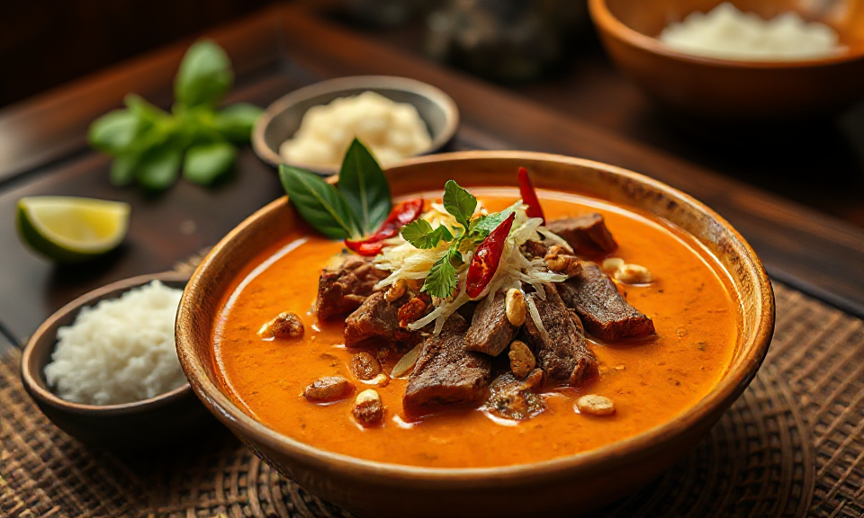

# Panang Curry

Panang Curry (auch Panaeng) ist für mich das cremigste und gleichzeitig mildeste der thailändischen Currys: weniger Kokosmilch als beim grünen oder roten Curry, dafür Erdnüsse, fein geschnittene Kaffirlimettenblätter und Rindfleisch in einer dickeren Sauce. Kennengelernt habe ich es im [Thai Food 1](https://www.thaifood1.de) in Nürnberg, wo es als Panaeng Neua auf der Karte steht. Nachgekocht habe ich es inzwischen ein paar Mal – hier meine kürzeste Version.

<!-- more -->

## Zutaten (für 2 Personen)

- 400 g Rindfleisch (z. B. Flanksteak oder Rinderhüfte), dünn geschnitten
- 2 EL Panang-Currypaste
- 400 ml Kokosmilch
- 3 EL Kokoscreme (oder der feste Teil der Kokosmilch)
- 2 EL Fischsauce
- 1–2 TL Palmzucker (alternativ brauner Zucker)
- 5 Kaffirlimettenblätter, sehr fein geschnitten
- 2 EL geröstete Erdnüsse, gehackt
- 1–2 rote Chilischoten, in feinen Ringen
- 1 EL neutrales Öl
- Jasminreis zum Servieren

## Zubereitung

1. Die Kokoscreme in einem Topf oder Wok bei mittlerer Hitze schmelzen.
2. Die Currypaste zugeben und zwei bis drei Minuten anbraten, bis sie duftet und sich das Öl leicht absetzt.
3. Das Fleisch zugeben und rundherum scharf anbraten.
4. Mit der Hälfte der Kokosmilch ablöschen und alles zehn Minuten sanft köcheln lassen.
5. Mit Fischsauce und Palmzucker würzen.
6. Die restliche Kokosmilch, die Kaffirlimettenblätter und die Erdnüsse unterrühren und weitere fünf Minuten köcheln lassen.
7. Noch einmal mit Fischsauce und Zucker abschmecken – die Sauce soll cremig sein und nicht suppig.
8. Mit Chiliringen bestreut und mit Jasminreis servieren.

## Quelle

- [Panang Curry mit Rind – cremig, nussig, Kaffir-duftend](https://kratai.de/index.php/blog/panang-curry-mit-rind-cremig-nussig-kaffir-duftend-authentisches-thai-rezept-fuer-zuhause): Vorlage für Zutaten und Mengen, Text und Reihenfolge hier gekürzt und vereinfacht.
