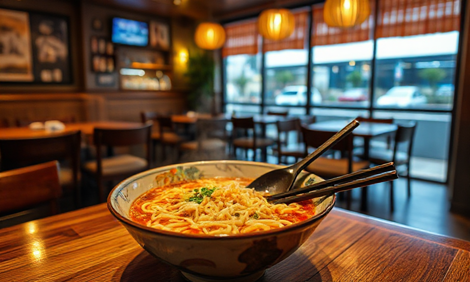

# Shin Ramyun Tuning

Als die Tochter 16 wurde, wollte sie direkt [Squid Game](https://de.wikipedia.org/wiki/Squid_Game) sehen, was ja erst ab 16 freigegeben ist. Darin gibt es eine Szene, in der die Akteure in einer Street Food Küche Shin Ramyun essen. Das haben wir direkt nachgemacht und uns einige Anregungen zum "Tuning" der Fertignudeln geholt.

<!-- more -->

**Shin Ramyun** wird im Asialaden in der typisch quadratischen Form mit beiliegenden Gewürzen und Saucen (leider alles in Plastik) angeboten. Das schmeckt an sich schon ok-ish, aber ich habe im Internet entdeckt, dass es da eine ganze Tuning-Szene gibt. Das sind die oft empfohlenen Hacks, von denen wir jetzt meist 1, 2, 3, 6 und 7 anwenden:

1. **Weniger Wasser (ca. 10-15% weniger):** Macht die Suppe intensiver und die Nudeln bissfester.
2. **Ei:** Entweder verquirlt kurz vor Ende einrühren (wird zu Eierflocken) oder als Ganzes pochieren lassen für mehr Cremigkeit.
3. **Milch (ein Schuss, 2-3 EL):** Mildert die Schärfe und macht die Brühe runder und cremiger, ähnlich wie bei Rosé-Ramen.
4. **Knoblauch (gehackt, in die kochende Brühe):** Verstärkt die Umami-Tiefe deutlich.
5. **Käse (ein Scheibletten oder etwas geriebener):** Klassischer koreanischer Trick für extra Cremigkeit.
6. **Butter (ein kleines Stück am Ende):** Rundet die Schärfe ab, ähnlich wie Milch, aber intensiver im Geschmack.
7. **Frühlingszwiebeln oder Zwiebeln mitkochen:** Süße und Frische gegen die reine Schärfe.
8. **Gochujang oder zusätzliche Chiliflocken:** Für alle, die es noch schärfer wollen, statt es abzumildern.

<iframe width="560" height="315" src="https://www.youtube-nocookie.com/embed/oqxAJKy0ii4?si=bEsYb-5-WW0Q8KHN" title="YouTube video player" frameborder="0" allow="accelerometer; autoplay; clipboard-write; encrypted-media; gyroscope; picture-in-picture; web-share" referrerpolicy="strict-origin-when-cross-origin" allowfullscreen></iframe>